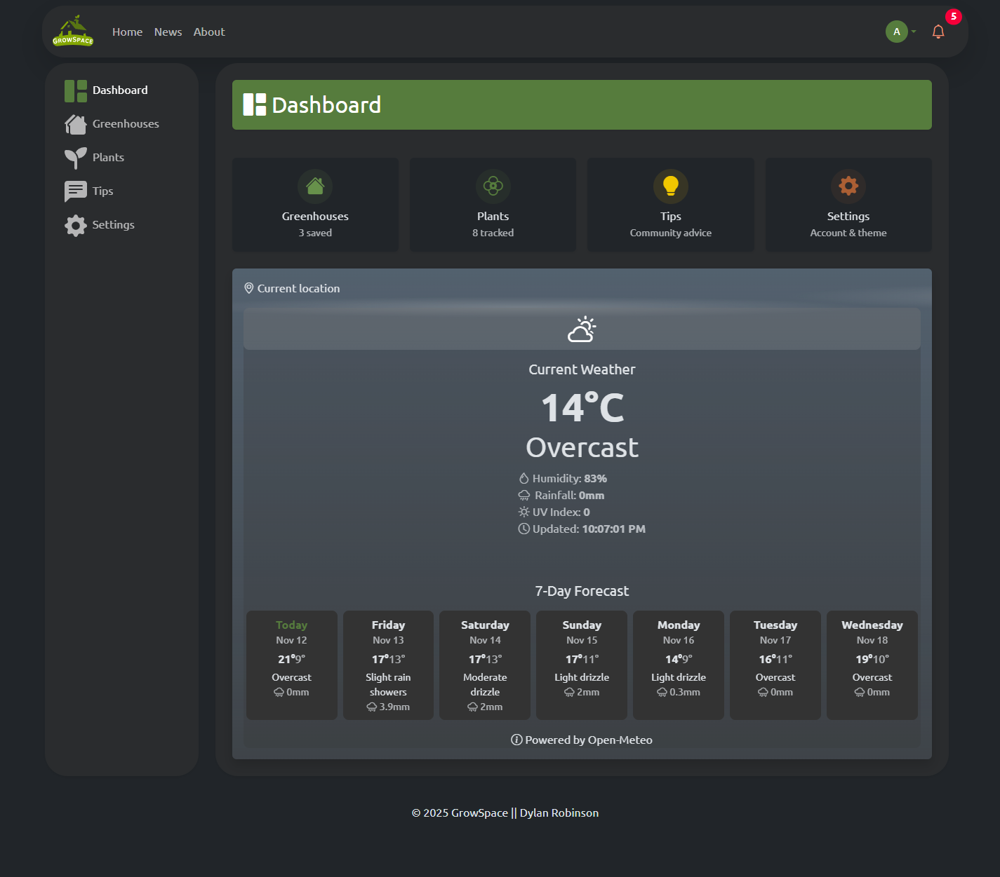
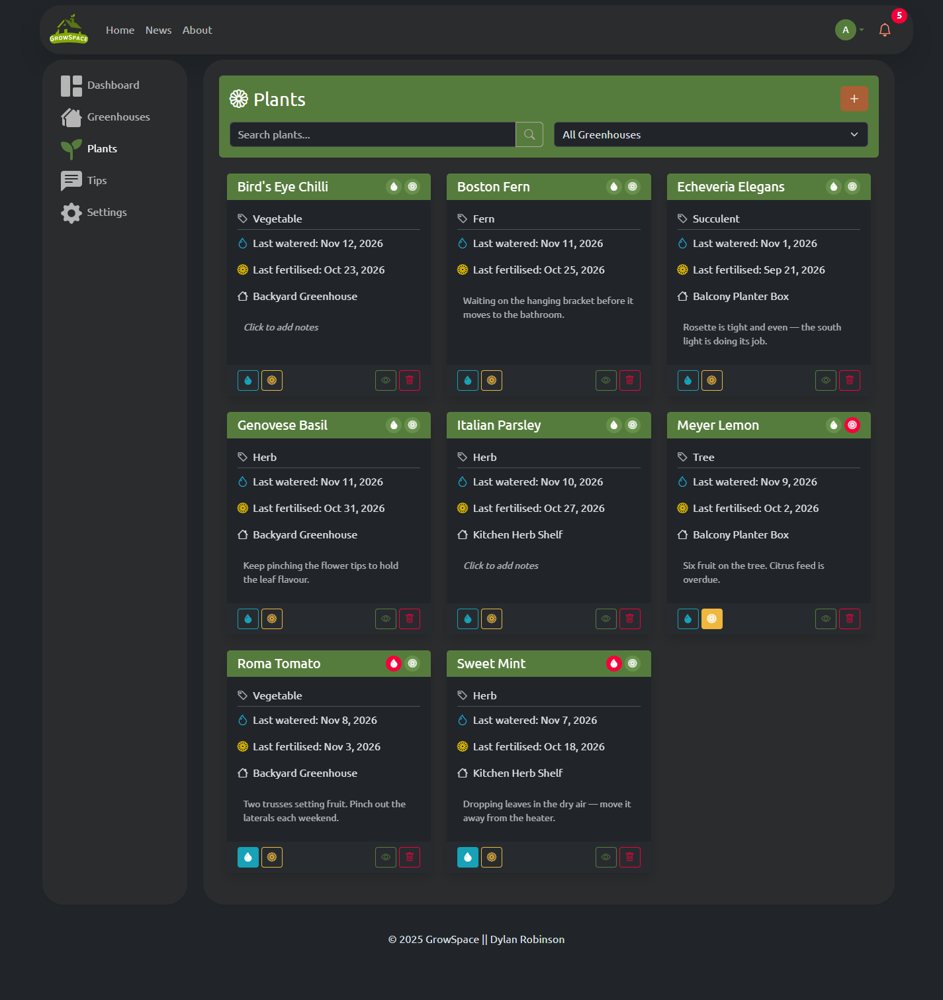
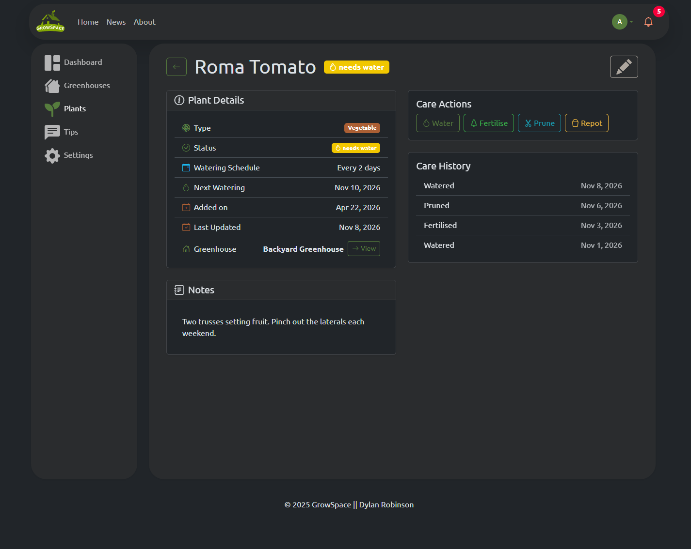
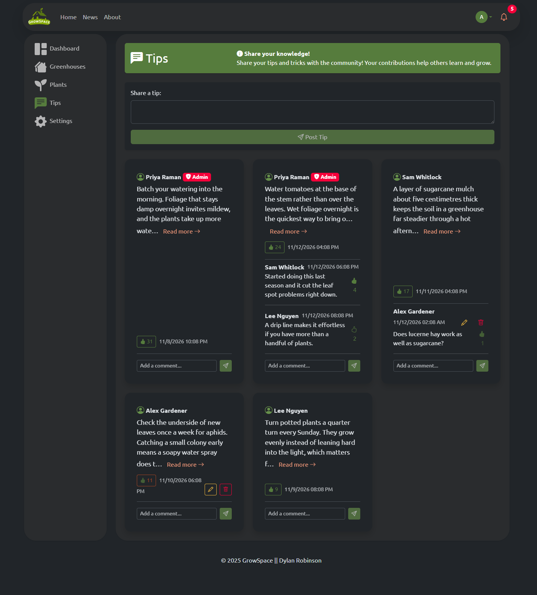
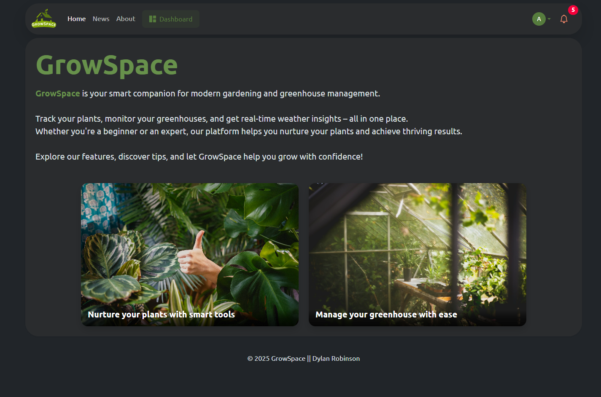
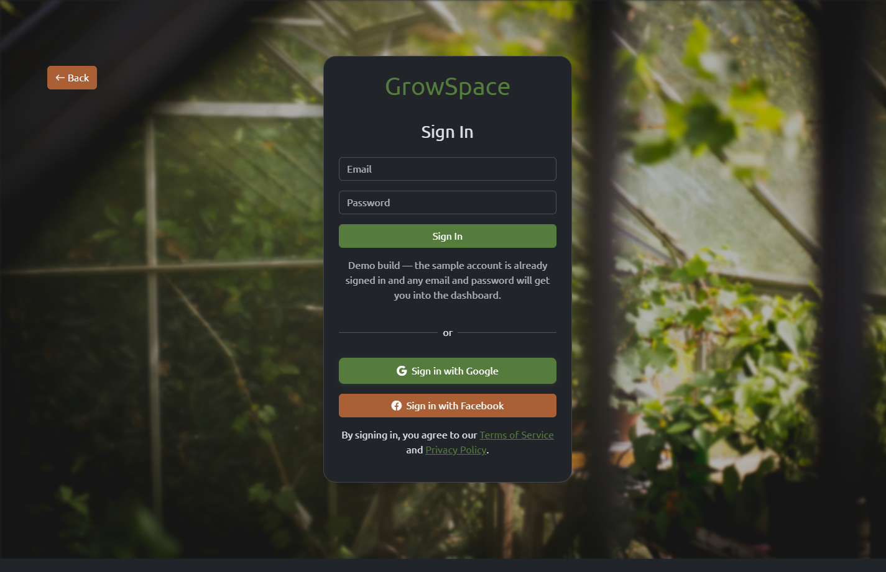

# GrowSpace

A greenhouse and plant tracker built with Vue 3 and Firebase. Keep track of
what is growing where, stay ahead of watering and fertilising, and swap tips
with other growers.



## What it does

**Greenhouses.** Create a greenhouse with a size and a location, then see the
plants in it.

**Plants.** Each plant has its own watering and fertilising interval. The app
works out when the next one is due, marks the plant as needing water once that
date passes, and keeps a history of care events so you can see what you did and
when.

**Weather.** The dashboard shows current conditions and a seven-day forecast
from Open-Meteo. It uses the browser's location, or a location you set yourself
in settings.

**Tips.** A small forum for sharing advice. You can post a tip, like other
people's tips and comment on them. Authors and admins can edit or delete their
own; everyone else reads and likes.

**Notifications.** A bell menu in the header, and optional browser
notifications, listing plants that are due for water or fertiliser.

**Accounts.** Email/password, Google and Facebook sign-in through Firebase
Auth, an editable display name, and account deletion that removes the user's
data along with their plants and tips.

**Theme.** Light, dark or follow the system, using Bootstrap's colour modes.
The choice is remembered in a cookie.

## Screenshots

These were taken in demo mode, so the plants and tips are sample data.

| | |
| --- | --- |
|  |  |
|  |  |
|  |  |

## Built with

Vue 3 with `<script setup>` components, Vue Router and Vite. Styling is
Bootstrap 5.3 plus a custom theme, and icons come from Bootstrap Icons. Data
and authentication are Firebase, the weather is Open-Meteo, and ESLint and
Prettier keep the source tidy.

## Running it locally

Node 20.19 or newer, or 22.12 and up, is required.

```sh
npm install
npm run dev
```

Then open <http://localhost:8080/cos30043/s101634222/project/app/>. The app is
built and served from that subdirectory rather than the site root, which is
what `base` in [vite.config.js](vite.config.js) sets.

### Demo mode

You do not need a Firebase project to look around. With no credentials
configured, Vite points `firebase/app`, `firebase/auth` and `firebase/firestore`
at the in-memory stand-ins in [src/js/demo](src/js/demo). A sample account is
already signed in and has three greenhouses, eight plants and a handful of
forum tips, all seeded from [mockData.js](src/js/demo/mockData.js). Adding,
watering or deleting things works, but the changes live in memory and reset on
reload.

### With your own Firebase project

1. Copy `src/.env.example` to `src/.env` and paste in the web app credentials
   from your Firebase project. Env files are read from `src/` because that is
   the Vite root.
2. Turn on the Email/Password, Google and Facebook providers in Firebase Auth
   if you want all three sign-in options.
3. Create a Firestore database. Data lives under `userData/{uid}` in the
   `greenhouses`, `plants`, `notifications` and `userPreferences`
   subcollections, plus a shared `tips` collection.

Once `VITE_FIREBASE_API_KEY` and `VITE_FIREBASE_PROJECT_ID` are filled in, the
demo modules drop out and the real SDK is used.

## Scripts

| Command | What it does |
| --- | --- |
| `npm run dev` | Dev server on port 8080 |
| `npm run build` | Production build into `app/` |
| `npm run preview` | Serve the production build on port 8080 |
| `npm run lint` | ESLint, with fixes |
| `npm run format` | Prettier over `src/` |

## Layout

```
src/
  assets/       images and the news fixture
  components/   public pages, dashboard screens and icons
  composables/  feature logic for greenhouses, plants, tips and settings
  css/          Bootstrap bundle and the custom theme
  js/
    auth/            Firebase setup and sign-in helpers
    demo/            in-memory Firebase stand-ins for demo mode
    weatherEffects/  rain and snow canvas effects
public/         icons, manifest and .htaccess shipped with the build
app/            the committed production build, which is what gets deployed
docs/           screenshots used above
```

## Worth knowing

There is no test suite. `npm test` is still the npm placeholder.

`app/` is build output and is committed because that folder is what is
deployed, so run `npm run build` after changing anything in `src/`.

## Author

Dylan Robinson, [@TheSpicyTacoGuy](https://github.com/TheSpicyTacoGuy)


